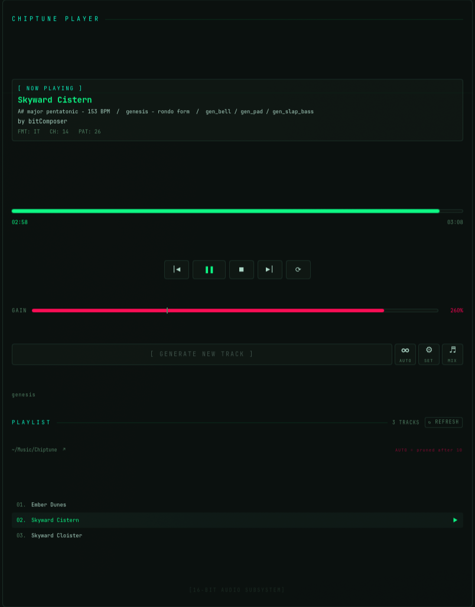

# bitComposer

[](https://github.com/CatDogBark/bitComposer/actions/workflows/ci.yml)
[](https://github.com/CatDogBark/bitComposer/releases/latest)


Procedural 16-bit game music. Pure Python, no dependencies, writes Impulse
Tracker `.it` modules you can play in any tracker player.

Every run composes a new song: a motif-based melody with call-and-response
phrasing, voice-led harmony, bass, arpeggio and drums, arranged into a form
(verse–chorus, AABA, rondo, through-composed) with an energy curve and a real
ending. Three sound palettes:

- **snes** — sampled-style voices rendered the way the SNES actually made sound: strings, brass, a formant choir, flute, organ, e-piano, bells, plucks and a gated drum kit at 16 kHz with loop points, passed through a BRR codec model for the grain, with the lead on a hardware-style echo.
- **genesis** — FM bells, brass, organ and bass.
- **chip** — square, pulse and triangle waves. Closest to NES and Game Boy.

**[Listen in your browser](https://catdogbark.github.io/bitComposer/)** — the actual modules, played live by libopenmpt in WebAssembly: two seeds rendered in all three palettes, straight from the generator, regenerated with each release.

## Quick start

```bash
git clone https://github.com/CatDogBark/bitComposer.git
cd bitComposer
python3 -m bitcomposer -d out            # writes out/<Title>.it
python3 -m bitcomposer -d out -s 42 -v   # reproducible, with details
```

Play the result with [OpenMPT](https://openmpt.org/) (Windows),
[Schism Tracker](https://schismtracker.org/), VLC, Audacious, `xmp`, or
anything built on libopenmpt. To install the `bitcomposer` command:

```bash
pip install .
```

Python 3.10 or newer. Nothing else.

## What you can steer

Everything defaults to `random`.

```
--style   chip|snes|genesis          sound palette
--echo    on|off|random              lead echo (random: 70% of snes songs, never chip or genesis)
--keys    moving|home                moving: choruses/bridges may change key; home: stay put
--tempo   slow|medium|fast           80–110 / 110–140 / 140–180 BPM
--energy  chill|normal|intense       density and arrangement weight
--scale   minor|major|pentatonic
--form    standard|aaba|rondo|short|linear
--drum-density sparse|normal|busy    --no-fills    --swing off|light|heavy
--melody  simple|phrased             phrased = motif-based, has a hook
--harmony-voicing thin|full          --harmony-mode stabs|sustain|rhythmic
--bass-weight heavy|medium|light
--name    title|timestamp            file naming; --suffix adds a marker
-s SEED   -n COUNT   -o FILE   -d DIR   -v
```

Some starting points:

```bash
# Overworld — bright, sampled palette with echo
bitcomposer -d out --style snes --scale major --tempo medium --form standard

# FM boss fight
bitcomposer -d out --style genesis --tempo fast --energy intense --scale minor --drum-density busy --form short

# Game Boy flavour — square waves, thin harmony, no echo
bitcomposer -d out --style chip --echo off --harmony-voicing thin --bass-weight light --form short

# Credits roll
bitcomposer -d out --style snes --tempo slow --energy chill --scale major --drum-density sparse --no-fills --form linear
```

## How it works

1. Pick a key and a scale weighted toward game music (minor pentatonic, dorian, harmonic minor, mixolydian…), then a progression for it. The tables include borrowed chords and secondary dominants — ♭VII, ♭VI, V/V — not just the diatonic set.
2. Choose a form and its energy curve; decide which sections repeat. Repeated sections draw the same music from the same seed, so the hook comes back.
3. Generate a motif (rhythm template plus contour) and vary it per bar in statement/answer pairs. Fourteen rhythm templates, six of them with 16th-note pushes and pickups.
4. Each four-bar pattern holds a chord timeline; about half the time the back two bars move to a related chord. Melody resolves onto chord tones at each change; harmony is voiced from fixed register anchors so it steps rather than leaps; bass and arp follow and rest with the section's energy.
5. Drums come from one-bar templates by section and density, with fills, retriggered snare rolls and tick-level swing.
6. Instruments are synthesized per song from the chosen palette and written as samples. SNES voices get attack-then-loop sustain and the BRR treatment.
7. The lead is copied to two echo channels, and everything is written as a 14-channel `.it` with the title and a song message (key, BPM, palette, form, seed) that trackers display.

Each song gets a seed-derived two-word title that leans with its scale:
*Haunted Orchard*, *Neon Causeway*, *Rusted Foundry*.

## Measuring instead of guessing

`tools/analyze.py` parses `.it` files back from disk (stdlib only, independent
of the generator) and scores a batch on the things that correlate with
"sounds like a song": section reuse, motif repetition, rhythmic grid, chord
voicing variety, voice motion, effect vocabulary, drum density.

```bash
python3 tools/analyze.py 'out/*.it'          # metric table
python3 tools/analyze.py --grid out/song.it  # tracker-style pattern dump
```

[docs/ANALYSIS.md](docs/ANALYSIS.md) is the story of this project: the
output was once limited by three silent arrangement bugs that nine commits
of ear-checking never caught, and every improvement since has been measured
before and after. Read it before changing the generator.

Tests:

```bash
python3 -m unittest discover -s tests -v
```

## Companion player (optional, Linux + KDE Plasma 6)



`companion/` holds a desktop player stack: a libopenmpt D-Bus daemon with
MPRIS2, a Plasma 6 panel widget with transport, gain, generator settings,
presets and a per-channel mixer, and an auto-generate "radio" mode that
composes the next track as the current one ends.

```bash
./companion/install.sh --check   # see what it would do
./companion/install.sh           # install, enable the daemon
```

See [docs/INSTALL.md](docs/INSTALL.md). The generator does not depend on
any of this.

## License

MIT. Every instrument is synthesized; no samples were taken from any game.
