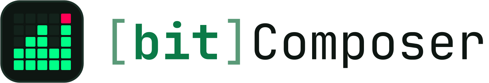
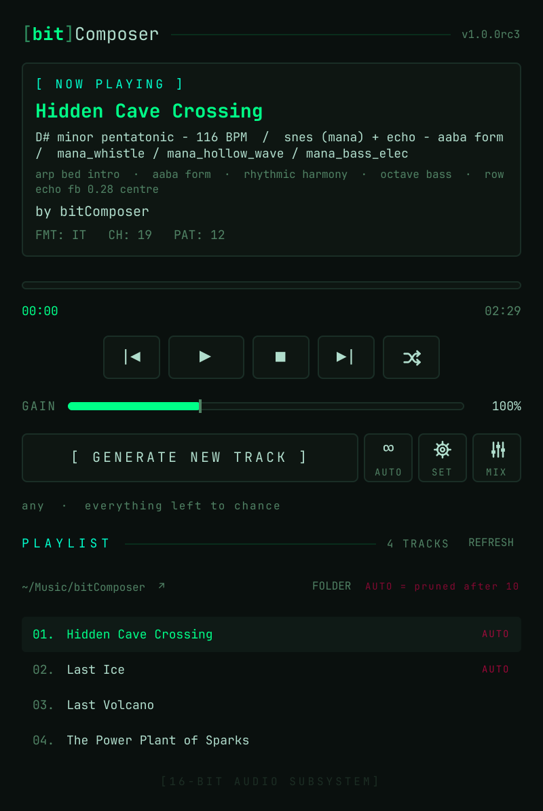

<h1>
  <picture>
    <source media="(prefers-color-scheme: dark)" srcset="docs/images/logo-dark.svg">
    
  </picture>
</h1>

*Endless music. Keep what moves you.*

[](https://github.com/CatDogBark/bitComposer/actions/workflows/ci.yml)
[](https://github.com/CatDogBark/bitComposer/releases/latest)


Procedural 16-bit game music. A player that composes the next song as the
current one ends, with a live mixer, on Linux and Windows; a command line
and a generator library underneath, pure Python with no dependencies,
writing Impulse Tracker `.it` modules any tracker player reads.

Every run composes a new song: a motif-based melody with call-and-response
phrasing, voice-led harmony, bass, arpeggio and drums, arranged into a form
(verse–chorus, AABA, rondo, through-composed) with a drawn intro, an energy
curve and a real ending, titled after what it drew, between 1:15 and 3:30
long. Seven sounds, picked with `--sound`:

- **snes** — sampled-style voices built the way the SNES made sound, through a BRR codec model and the SNES echo.
- **ffvi**, **mana**, **evermore**, **megamanx** — style packs: an instrument set rebuilt from each game's own sound chip (every sample profiled, nothing copied) plus the arrangement habits of its score. Details under [Sounds](#sounds).
- **genesis** — FM bells, brass, organ and bass.
- **chip** — square, pulse and triangle waves. Closest to NES and Game Boy.

**[Listen in your browser](https://catdogbark.github.io/bitComposer/)** — the actual modules, played live by libopenmpt in WebAssembly: one song per sound, straight from the generator, regenerated with each release.

**Reproducible, not frozen.** The same seed on the same version gives the same song, byte for byte. A new version may change what a seed draws, and the song message records the version that wrote the file.

## Install

**Windows.** Every release carries `bitComposer-setup.exe`: the player, the
command line, a Start menu entry and an uninstaller; or `bitComposer-windows.zip`,
the same program as a folder with nothing to install. No Python needed. See
[Windows](#windows).

**Linux.** From PyPI with [pipx](https://pipx.pypa.io/), so it lands on your
PATH without touching the system Python (Debian and Fedora refuse a plain
`pip install` there; `sudo apt install pipx libopenmpt0` or
`sudo dnf install pipx libopenmpt` gets pipx and the module library). The
player's window is Qt, which pipx brings along (PySide6, about 80 MB):

```bash
pipx install bitcomposer
bitcomposer-player
```

That first launch adds bitComposer to your app menu (under Multimedia,
with its icon); from then on start it from there like any other program.
The command line is `bitcomposer`, e.g. `bitcomposer -d out -s 42 -v` for
a reproducible song with details.

The player needs libopenmpt (above) and an audio output: `paplay`
(pulseaudio-utils), `pw-cat` (pipewire-bin) or `aplay` (alsa-utils).
`bitcomposer-player --check` says what it found. Upgrades: the UPDATE
button in the player, or `pipx upgrade bitcomposer`.

To uninstall, take the menu entry out first (pipx cannot), then the
program:

```bash
bitcomposer-player --remove-desktop
pipx uninstall bitcomposer
```

A menu entry you delete yourself stays deleted;
`bitcomposer-player --install-desktop` puts it back.

From a clone, for development, or for the generator alone: the command
line needs nothing but Python, and only the player needs Qt.

```bash
git clone https://github.com/CatDogBark/bitComposer.git
cd bitComposer
python3 -m bitcomposer -d out
```

Play the result with [OpenMPT](https://openmpt.org/) (Windows),
[Schism Tracker](https://schismtracker.org/), VLC, Audacious, `xmp`, or
anything built on libopenmpt.

Python 3.10 or newer. The generator has no dependencies; the player's
window is Qt (PySide6, installed with the package).

## Sounds

A style pack pairs an instrument set with the arrangement habits of the score it imitates. Each is built from the game's SPC snapshots: every sample decoded and profiled, matched to the community's instrument tables where they exist, and re-synthesised; nothing from the games is in the repository.

- `ffvi`: every voice modelled on the game's own sample bank and named by its instrument table: the chorused string section, flutes in chords, the dark synth lead of Locke and the Returners, trumpet, trombone, oboe, Terra's and Cyan's pan flutes, cello, choir, pipe organ and rock organ, the Aria's soprano, the Battle theme's distortion guitar, piano, harp, picked string, acoustic guitar, tubular bell, xylophone, a bass guitar and a kit of its own (kick, snare, hats, cymbal, timpani, wood block), with ostinato strings, a brass counter-line in the chorus, timpani rolls into sections and the game's short, wet echo. 
- `mana`: every voice modelled on the game's own sample bank: a soft slow-breathed flute, bright chorused strings, an 'ah' choir, a high whistle, soft and synth brass, marimba, vibraphone, electric piano, tubular bell, reed, accordion, glass and sine pads, fingered, electric and slap basses and a kit of its own (kick, snare, hats, crash, tom, castanet), with major and pentatonic keys, syncopated harmony, bouncy arps, light swing, the kick and snare set back and the game's one-row echo. 
- `evermore`: every voice modelled on the game's own sample bank: a slow bright string swell, a warm pad, a dark pad, a glass bell, a breathy flute, a reed, an "oo" choir, harp, tinker music box, piano, pluck and kalimba, a textured drone and a wind loop, a bass, and a quiet kit (soft kick, frame drum, brushes, hat, cymbal, wood ping), with slow tempos, sustained harmony, a drone bass, sparse or no drums, long linear forms and the game's sparing 80 ms echo. 
- `megamanx`: every voice modelled on the game's own sample bank and named by it: a driven, chorused lead guitar, a chugging rhythm guitar on power chords, the overdrive guitar for arps and counter-lines, synth brass, strings, a guitar swell pad, a saw pad, organ, the boomer synth lead, square and bright leads, a hollow wave, a bell synth, an acoustic pluck, the orchestra hit for stabs, slap and synth basses on a riff, and a tight kit, at fast tempos in minor keys with the game's 48 ms slapback echo.

`--sound` picks a palette or a pack in one word; left to chance, the four packs together weigh as much as plain snes.

- **snes** — sampled-style voices rendered the way the SNES actually made sound: strings, brass, a formant choir, flute, organ, e-piano, bells, plucks and a gated drum kit at 16 kHz with loop points, passed through a BRR codec model for the grain, with the lead, harmony and arp through an echo modelled on the SNES unit's result: fading, darkening repeats on a beat fraction, drawn per song.
- **genesis** — FM bells, brass, organ and bass.
- **chip** — square, pulse and triangle waves.

## What you can steer

Everything defaults to `random`.

```
--sound   chip|snes|genesis|ffvi|mana|evermore|megamanx  the sound in one word: a palette or a style pack (overrides the two below)
--style   chip|snes|genesis          sound palette
--pack    ffvi|mana|evermore|megamanx|none|random  style pack: an instrument set with the habits of the scores it imitates (a pack implies snes)
--pack-file PACK.json               a pack as data, with its own voices as WAV files (docs/PACKS.md); overrides --pack and --sound
--echo    on|off|random              echo (random: 70% of snes songs, never chip or genesis)
--echo-wet    light|normal|wet|random  how much of the lead, harmony and arp the echo carries
--echo-delay  eighth|dotted|quarter|slap|row|random  beat fraction between repeats, a 48 ms slap, or one row (random: weighted by tempo)
--echo-stereo bounce|centre|random     repeats alternate sides, or sit under their source
--keys    moving|home                moving: choruses/bridges may change key; home: stay put
--tempo   slow|medium|fast           80–110 / 110–140 / 140–180 BPM
--energy  chill|normal|intense       density and arrangement weight
--scale   minor|major|pentatonic
--form    standard|aaba|rondo|short|linear
--drum-density sparse|normal|busy    --no-fills    --swing off|light|heavy
--melody  simple|phrased             phrased = motif-based, has a hook
--harmony-voicing thin|full          two real voices, or three
--harmony-mode stabs|sustain|rhythmic
--bass-weight heavy|medium|light
--lead-shift SEMITONES               move the lead's window (negative lowers it); default: the sound's own
--name    title|timestamp            file naming; --prefix / --suffix add a marker ("(auto) " is the player's)
-s SEED   -n COUNT   -o FILE   -d DIR   -v
```

Some starting points:

```bash
# Overworld — bright, sampled palette with echo
bitcomposer -d out --style snes --scale major --tempo medium --form standard

# FM boss fight
bitcomposer -d out --style genesis --tempo fast --energy intense --scale minor --drum-density busy --form short

# Game Boy flavour — square waves, thin harmony, no echo
bitcomposer -d out --style chip --echo off --harmony-voicing thin --bass-weight light --form short

# Credits roll
bitcomposer -d out --style snes --tempo slow --energy chill --scale major --drum-density sparse --no-fills --form linear
```

## How it works

1. Pick a key and a scale weighted toward game music (minor pentatonic, dorian, harmonic minor, mixolydian…), then a progression for it. The tables include borrowed chords and secondary dominants — ♭VII, ♭VI, V/V — not just the diatonic set.
2. Choose a form and its energy curve; decide which sections repeat. Repeated sections draw the same music from the same seed, so the hook comes back.
3. Generate a motif (rhythm template plus contour) and vary it per bar in statement/answer pairs. Fourteen rhythm templates, six of them with 16th-note pushes and pickups.
4. Each four-bar pattern holds a chord timeline; about half the time the back two bars move to a related chord. Melody resolves onto chord tones at each change. Harmony is two or three real voices placed near fixed anchors, so it steps rather than leaps and keeps the chord's third; the anchors are set per voice family (pads low and wide, brass and guitars mid and close), the top voice stays under the lead's line, and a stab holds for as long as the voice needs to speak. Bass and arp follow and rest with the section's energy.
5. Drums come from one-bar templates by section and density, with fills, retriggered snare rolls and tick-level swing.
6. Instruments are synthesized per song from the chosen palette and written as samples. SNES voices get attack-then-loop sustain and the BRR treatment.
7. The echo: held lead notes and phrase endings come back as three fading, darkening repeats, the harmony and arp as lighter ones, each on return channels of their own, drums and bass dry. Everything is written as a 19-channel `.it` with the title and a song message (key, BPM, palette, form, seed, and a `layout:` line naming every channel's role) that trackers display.

Each song gets a title that reads the song: its scale, sound, energy and
tempo lean the words, so a slow minor Evermore piece and a fast Mega Man X
track are named differently (*Lunar Snow*, *Lighthouse of Steel*, *The
Power Plant of Sparks*).

## Measuring instead of guessing

`tools/analyze.py` parses `.it` files back from disk (stdlib only, independent
of the generator) and scores a batch on the things that correlate with
"sounds like a song": section reuse, motif repetition, rhythmic grid, chord
voicing variety, voice motion, effect vocabulary, drum density.

```bash
python3 tools/analyze.py 'out/*.it'          # metric table
python3 tools/analyze.py --grid out/song.it  # tracker-style pattern dump
```

[docs/ANALYSIS.md](docs/ANALYSIS.md) is the story of this project: the
output was once limited by three silent arrangement bugs that nine commits
of ear-checking never caught, and every improvement since has been measured
before and after. Read it before changing the generator.

Tests:

```bash
python3 -m unittest discover -s tests -v
```

## SPC import (developer preview)

bitComposer is starting to learn from the games its packs imitate.
`python -m bitcomposer.spc --to-it song.it game.spc` runs an SPC file's own
music driver in an emulator of the SNES sound hardware and writes the song as
an IT module (its samples, notes, envelopes and echo), and
`tools/spc_check.py` measures the module against the original, voice by
voice. It needs the emulator, `bitcomposer-emu`, built from source (Rust;
CONTRIBUTING.md has how); it is not on PyPI yet. Making a pack from a
soundtrack comes later (`docs/SPC-IMPORT.md`; what has been tested, and how
well it converts, is in `docs/drivers/`). The SPC files are yours:
bitComposer ships none.

## The player



`bitcomposer-player` (Linux) and `bitComposer.exe` (Windows) are the same
program: a folder of songs played through libopenmpt, GENERATE AND PLAY,
auto-generate when a track ends (the "radio"), the settings of what it
composes (sound, tempo, energy, scale, form, echo, bass, drums, harmony)
with presets, a live mixer per channel with the KIT and ECHO buses and
APPLY TO TRACK to write the mix into the file, gain with a soft limiter,
shuffle, and the playlist with KEEP: every track the player makes is
provisional (`(auto) <Title>.it`, so a file browser sorts them together)
and pruned after ten unless kept. It
opens no taller than the screen it lands on, the
SET and MIX panels open inside it (scrolling on a small or scaled
screen), and it keeps the size you give it; Ctrl + and
Ctrl − zoom it, Ctrl 0 resets. Closing the window leaves the music playing
in the tray (quit from the tray menu), and starting it again brings that
window back rather than a second player. The media keys drive it: on
Linux through the desktop's media controls (MPRIS, so the Plasma media
applet and lock screen, GNOME and `playerctl` see it too), on Windows as
global keys. SET → PLAYER → LOGIN, or the tray menu, starts it when you
log in: in the tray, not playing. When a newer
release exists an UPDATE button appears. It says what the update will do,
then shows it happening: on Linux it reinstalls through pipx, pipx's
output scrolling past, and restarts the player; on Windows it downloads
the release's installer and runs it. A player installed from a release candidate is
offered the next candidate; a release player only releases.

## Windows

Every release carries `bitComposer-setup.exe` (the installer) and `bitComposer-windows.zip` (the same `bitComposer` folder, no install), built by GitHub Actions on every push to main and attached on the tag: `bitComposer.exe`, the player, with Qt and libopenmpt beside it; and `bitcomposer-cli.exe`, the command line. The installer installs for your user by default (no administrator prompt; all users is an option on its first page), and the player's UPDATE button runs the next one quietly and reopens the player. Each build also renders the player offscreen at common screen sizes and scalings (1366×768, 1920×1080 at 100% and 150%, 2560×1440 at 125%, 4K at 200%), kept as the workflow's `player-screenshots-windows` artifact. Songs are `.it` files; [OpenMPT](https://openmpt.org) and XMPlay play them too. Windows releases are to be code-signed through the SignPath Foundation's programme for open-source projects (see [Code signing policy](#code-signing-policy)); until that is in place they are unsigned, so SmartScreen asks once ("More info", "Run anyway"). With Python installed instead, `pipx install bitcomposer` gives the same programs as `bitcomposer-player` and `bitcomposer`.

## Code signing policy

Free code signing provided by [SignPath.io](https://about.signpath.io), certificate by [SignPath Foundation](https://signpath.org).

Status: applied for in October 2026. Until it is approved, the Windows builds are unsigned.

What is signed: the Windows release files built by this repository's GitHub Actions workflow from the source in this repository: `bitComposer.exe`, `bitcomposer-cli.exe` and `bitComposer-setup.exe`. Libraries included from upstream projects (Python, Qt, libopenmpt) are their own projects' builds.

- Committers and reviewers: [CatDogBark](https://github.com/CatDogBark)
- Approvers: [CatDogBark](https://github.com/CatDogBark)

Every release is approved by hand before it is signed. Everyone with these roles uses multi-factor authentication on GitHub and SignPath.

## Privacy

bitComposer composes and plays music on your computer. It collects nothing about you, your music or how you use it, and sends none of it anywhere.

One thing goes over the network on its own: when the player starts, it asks GitHub's public releases list (`api.github.com`) whether a newer version exists, so it can offer the UPDATE button. That request carries only what any web request does (your IP address and the program's name), and [GitHub's privacy statement](https://docs.github.com/site-policy/privacy-policies/github-general-privacy-statement) covers it. Turn it off in the player under SET → PLAYER → UPDATES. Updating itself downloads only when you press UPDATE: the installer from GitHub on Windows, the package from PyPI with pipx.

The [listening page](https://catdogbark.github.io/bitComposer/) is a website: GitHub Pages serves it and Google Fonts serves its font, each under its own privacy policy. It plays the songs in your browser and keeps nothing.

## License and contact

MIT, copyright 2026 Enlightened Solutions LLC (see [LICENSE](LICENSE)).
Every instrument is synthesized; no samples were taken from any game.

Bugs and ideas: [GitHub issues](https://github.com/CatDogBark/bitComposer/issues).
Anything else: CatDogBark, catdogbark@pm.me.
