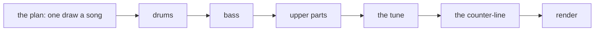
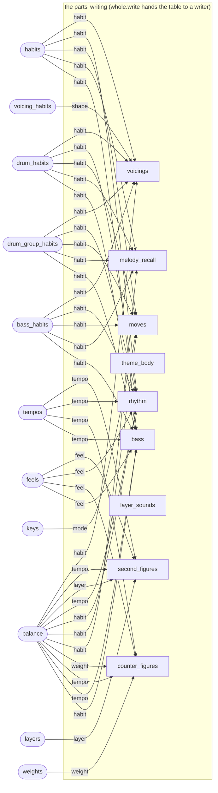
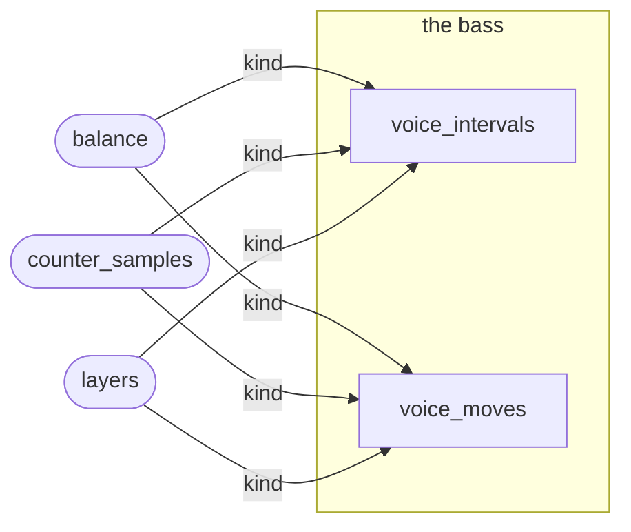
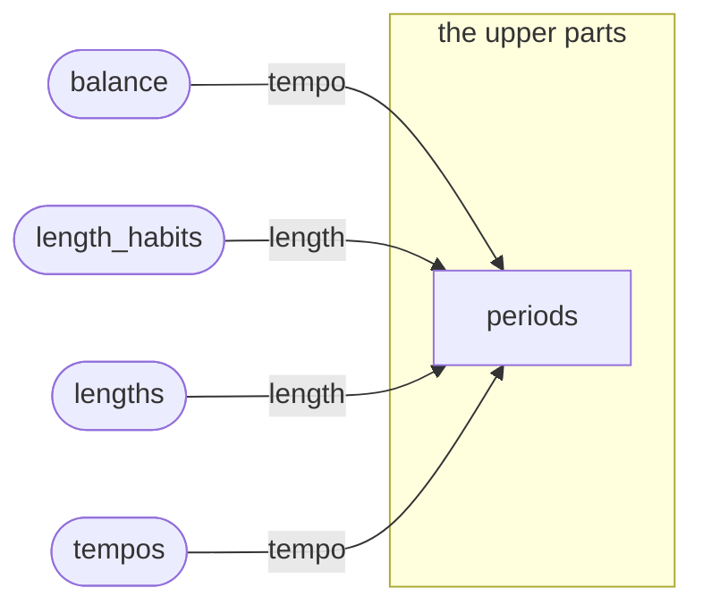
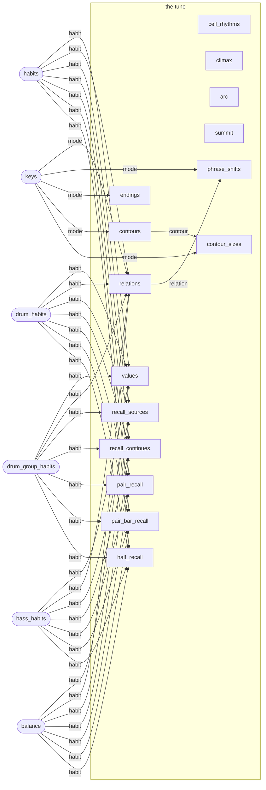
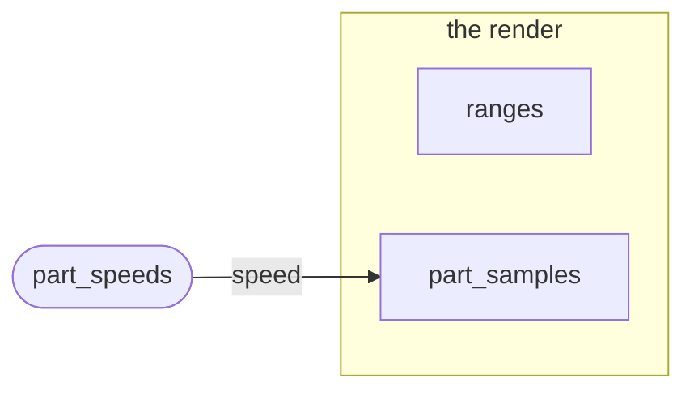
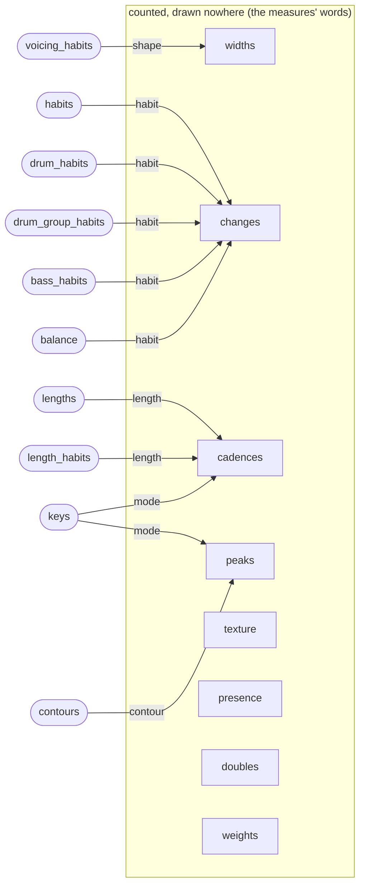

# The vocabulary's map

Generated by `python tools/vocab_map.py --out docs/idiom/vocabulary-map.md` from `packtables.KEPT` and the writer's
source; do not edit by hand. The words themselves, what each counts and why it exists, are in `VOCABULARY.md`;
this page is the index and the wiring: each table's shape (its conditionings), where it is drawn, and which
tables its outcome conditions in turn (`SOURCES` in the tool names which table gives a conditioning its value).

## The writing, stage by stage



### the plan, drawn once a song (53)

| table | shape | drawn in | conditions | what it counts |
|---|---|---|---|---|
| `habits` | part, tempo, weight | _plan_once, compose, game_habits, habit_near, melody_models, write_melody, write_upper | `bass`, `cell_handoffs`, `changes`, `drum_group_habits`, `drums`, `drums-KSt`, `drums-c`, `drums-h`, `drums-o`, `half_recall`, `kit_pieces`, `lengths`, `melody_recall`, `moves`, `pair_bar_recall`, `pair_recall`, `part_entries`, `part_speeds`, `part_textures`, `recall_continues`, `recall_sources`, `relations`, `rhythm`, `tune_grain`, `values`, `voicings` | a part's density and repetition habit, drawn once a song given the tempo and the part's weight in the band |
| `bass_habits` | part, tempo, weight | _plan_once, write, write_bass | `bass`, `cell_handoffs`, `changes`, `drum_group_habits`, `drums`, `drums-KSt`, `drums-c`, `drums-h`, `drums-o`, `half_recall`, `kit_pieces`, `lengths`, `melody_recall`, `moves`, `pair_bar_recall`, `pair_recall`, `part_entries`, `part_speeds`, `part_textures`, `recall_continues`, `recall_sources`, `relations`, `rhythm`, `tune_grain`, `values`, `voicings` | the bass's habit (density, tones, octaves), drawn once a song given the tempo and its weight |
| `drum_habits` | part | _plan_once | `bass`, `cell_handoffs`, `changes`, `drum_group_habits`, `drums`, `drums-KSt`, `drums-c`, `drums-h`, `drums-o`, `half_recall`, `kit_pieces`, `lengths`, `melody_recall`, `moves`, `pair_bar_recall`, `pair_recall`, `part_entries`, `part_speeds`, `part_textures`, `recall_continues`, `recall_sources`, `relations`, `rhythm`, `tune_grain`, `values`, `voicings` | the drums' density habit, drawn once a song |
| `kit_pieces` | part, habit | _plan_once | `drums` | the kit pieces a song's drums strike (letters: kick, snare, hat, tom, cymbal, other), by the kit's habit tier, drawn once a song |
| `voicing_habits` | part | _plan_once, write_upper | `voicings`, `widths` | an upper part's richness habit, drawn once a song |
| `motions` | part | _plan_once, write_upper | - | how an upper part moves through its tones (block, mixed, arpeggiated), drawn once a song |
| `chords` | part, mode, previous | plan_chords | - | a bar's chord as a numeral in the key, after the bar before's |
| `loops` | part | plan_chords | - | the chord the loop returns to |
| `form` | part, meter, index | plan_form | `part_entries`, `part_textures`, `phrase_letters`, `section_levels` | a part of the form: new, again or back, by its index |
| `lengths` | part, meter, habit | plan_form | `cadences`, `part_entries`, `periods` | a part's length in bars, by the song's habit |
| `letters` | part | _plan_once, carry_theme, plan_form, write | `part_entries`, `part_textures`, `phrase_letters`, `section_levels` | a song's form as its parts' letters in order (A B A B C), drawn whole |
| `phrase_letters` | part, phrases, form | _plan_once | - | a part's phrases as letters: the theme head again, an earlier head again, or new |
| `return_band` | part | _plan_once | - | which of the chords, the bass and the accompaniment come back with the theme |
| `theme_doubling` | part, place | double_theme | - | which other parts double the theme's cell where the tune plays it, and how far from the tune, at its statement or later |
| `tune_doubling` | part, place | double_theme | - | which other parts double the tune's cell in a bar that is not the theme's, and how far from the tune |
| `theme_carrier` | part | carry_theme | - | the part that carries the theme phrase where the tune's phrase is not the theme: the bass, the counter, the accompaniment, or none |
| `step_habits` | part | _plan_once, melody_models, write_melody | - | how stepwise a song's tune is (leaping, mixed, stepwise), drawn once a song |
| `repeat_habits` | part | _plan_once, melody_models, write_melody | - | how often a song's tune repeats a note (rare, some, many), drawn once a song |
| `echo_habits` | part, tempo, weight | _plan_once, melody_models, write_melody | - | how much of its tune a song echoes bar by bar, drawn once a song |
| `parts` | part, band | compose | `voices` | whether a song has each part, by the band's size |
| `voices` | part, band | compose | - | how many voices a song uses |
| `layers` | part, rank | _plan_once, layers_of | `second_figures`, `voice_intervals`, `voice_moves` | what each voice of a part beside its line does, by its rank: doubling at an interval, alternating, or apart (how far off, how dense) |
| `feels` | part | _plan_once | `bass`, `counter_figures`, `drums`, `drums-KSt`, `drums-c`, `drums-h`, `drums-o`, `rhythm`, `second_figures` | a song's feel, duple or triple (a quarter of its onsets or more on triplet positions), drawn once a song; every figure table is drawn by it |
| `period_holds` | part, period | _plan_once | - | inside a backing part's period, a bar playing the bar a period before again (held) or not (varied) |
| `layer_samples` | part | pair_for | - | the samples a layered part's line and its second voice play, as a pair, drawn once a song |
| `counter_samples` | part | _plan_counter | `voice_intervals`, `voice_moves` | whether a song's counter-line plays the tune's sample (same) or another (other), drawn once a song: the kind its interval and move words are drawn under, and its sample at the rendering |
| `counter_shares` | part, tune | _plan_counter | - | the counter-line's level as a share of the song's loudest part's, in tenths, by the band the tune's own share falls in, drawn once a song after the tune's |
| `counter_pairs` | part, tune | counter_pair_for | - | the counter-line's sample where it plays another than the tune's, by the tune's sample (the pack's ids), drawn once a song at the rendering |
| `sample_lengths` | part, speed | sample_floor | - | the shortest note a sample is played at (ms, a class), by the sample and its speed class in the song (slow, medium, fast): a note's floor on it |
| `sample_speeds` | part | sample_speed | - | the fastest bars a sample is played in (notes a second, a class), by the sample: weighed in its choice for a part |
| `cell_handoffs` | part, habit, place | hand_off_cells | - | a tune's half-bar cell taken up by another part in a later bar: which part and how many bars on, by the song's echo habit and the cell's place (theme or other) |
| `part_speeds` | part, habit | _plan_speeds | `gap_sounds`, `part_samples`, `sample_lengths` | a part's fastest bars (notes a second, a class), by the part and its habit's density: what its sample is fitted to for speed before the part is written |
| `registers` | part | _plan_once | - | the register a part plays in (midi low-high) |
| `keys` | part | _plan_once | `cadences`, `chords`, `contour_sizes`, `contours`, `endings`, `moves`, `peaks`, `phrase_shifts`, `relations` | a song's key, tonic and mode |
| `tempos` | part, tempo | _plan_once | `bass`, `bass_habits`, `counter_figures`, `drums`, `drums-KSt`, `drums-c`, `drums-h`, `drums-o`, `echo_habits`, `habits`, `periods`, `rhythm`, `second_figures` | a song's tempo, to five beats a minute, by its class (the balance token's since round 54) |
| `sizes` | part | plan_form | - | how many parts a song's form has |
| `length_habits` | part | plan_form | `cadences`, `part_entries`, `periods` | a song's part-length habit (short, medium, long), drawn once a song |
| `balance` | part | ?, _plan_once | `bass`, `bass_habits`, `cell_handoffs`, `changes`, `counter_figures`, `counter_pairs`, `counter_shares`, `drum_group_habits`, `drums`, `drums-KSt`, `drums-c`, `drums-h`, `drums-o`, `echo_habits`, `habits`, `half_recall`, `kit_pieces`, `lengths`, `melody_recall`, `moves`, `pair_bar_recall`, `pair_recall`, `part_entries`, `part_speeds`, `part_textures`, `parts`, `periods`, `recall_continues`, `recall_sources`, `relations`, `rhythm`, `second_figures`, `tempos`, `tune_grain`, `values`, `voice_intervals`, `voice_moves`, `voices`, `voicings` | a song's band with each part's weight, register, sounded share, voices, level (a share of the loudest part's, in tenths) and, for a layered part, each voice beyond the line's level over the line's (in tenths, the busiest first) and, for the counter, whether it plays the tune's sample (same/other) in it, drawn once a song as one unit |
| `sounds` | part | _plan_once | - | the share of its gap a part's note sounds |
| `gap_sounds` | part, voice, speed, gap | _plan_once, _plan_sounds | - | the share of its gap a note sounds, by the voice, the part's speed class (its fastest bar: slow, medium, fast) and the gap's length (under a beat, one to two, two to four, a bar or more) |
| `bass_locks` | part | _plan_once | - | the share of the kit's accents (two pieces together) the bass strikes with, in tenths |
| `levels` | part | _plan_once | `counter_pairs`, `counter_shares` | a part's level as a share of the song's loudest part's, in tenths |
| `top_levels` | part | _plan_once | - | a song's loudest part's level of full, drawn once a song: what the band's shares are shares of |
| `layer_levels` | part | _plan_once | - | a layered part's second voice's level against its line's, in tenths (the fallback for a part the balance token has no second-voice shares for) |
| `sample_ambitus` | part | ambitus_of | - | the whole range a sample is played in, lowest note to highest, by the sample: the tune's bound |
| `articulation` | part | _plan_once, melody_models, write_melody | - | the tune's articulation habit (detached, mixed, held), drawn once a song |
| `part_textures` | part, habit, form, previous | plan_texture | - | the texture a part of the form keeps (which parts sound), by the kit's density tier (round 59; NO_TIER without drums), its place in the form and the part before's |
| `section_levels` | part, form | _plan_once, plan_section_levels | - | a part's level in a section over its level in the whole song, in tenths, by the part and the section's place in the form: dynamics by section |
| `part_entries` | part, habit, form, length | _plan_once, plan_texture | - | where inside a section a part present in it enters and leaves (so many bars after its start, so many before its end, or whole), by the part, for the drums the kit's density tier (round 59), the section's place in the form and its length class |
| `drum_group_habits` | part, habit | _plan_once | `bass`, `cell_handoffs`, `changes`, `drums`, `drums-KSt`, `drums-c`, `drums-h`, `drums-o`, `half_recall`, `kit_pieces`, `lengths`, `melody_recall`, `moves`, `pair_bar_recall`, `pair_recall`, `part_entries`, `part_speeds`, `part_textures`, `recall_continues`, `recall_sources`, `relations`, `rhythm`, `tune_grain`, `values`, `voicings` | a drum group's own habit given the kit's, drawn once a song |
| `chord_tones` | part | _plan_once, write | - | the share of the tune's notes on a beat that are chord tones, drawn once a song |
| `repeat_rates` | part | _plan_once | - | the share of the tune's moves that repeat the note, drawn once a song |
| `tune_grain` | part, habit | _plan_once | - | the tune's grain (on-beat, eighths, fine: its share of onsets off the beat), by the part and its habit's density tier, drawn once a song and held over the melody writer's new rhythms |

### the parts' writing (whole.write hands the table to a writer) (9)

| table | shape | drawn in | conditions | what it counts |
|---|---|---|---|---|
| `rhythm` | part, meter, tempo, habit, feel, previous | melody_models, write, write_upper | - | a part's bar as an onset pattern (an upper part's own line where it holds two voices or more) |
| `bass` | part, meter, tempo, habit, feel, previous | fit, write, write_bass | - | the bass's bar as a figure: positions with chord-tone marks |
| `voicings` | part, shape, habit | write, write_upper | - | which chord tones an upper part holds in a span |
| `theme_body` | part | write | - | how much of the theme phrase comes back with its head |
| `moves` | part, mode, habit, place, tone, previous | melody_models, write | - | the tune's move note to note, under the song's stepwise habit, by where the arriving note falls in its beat and the tone the note left stands on against the chord, after the move before |
| `melody_recall` | part, habit | melody_models, write, write_melody | - | the tune's urn: a bar the same as the one before, an earlier one again, or new, by the song's echo habit |
| `layer_sounds` | part, voice | write | - | the share of its gap a note sounds for a layered part's line and for its second voice |
| `second_figures` | part, layer, feel, tempo, onsets, line | write | - | a layered part's second line, under its voices' note share over the line (sparse, half, full; round 65) (an upper part's pattern, the bass's figure) under the line's own bar, by the song's feel and tempo band, where the part holds two voices or more |
| `counter_figures` | part, weight, feel, tempo, onsets, line | write | - | the counter-line's bar as a mask over the tune's bar: which of the tune's onsets it strikes with and its own, by the counter's weight in the band, the song's feel and tempo band, the tune's onset count and pattern (its own onsets alone where the tune rests) |

### the drums (5)

| table | shape | drawn in | conditions | what it counts |
|---|---|---|---|---|
| `drums` | part, meter, kit, tempo, habit, feel, previous | compose, drums, samples_for, write | - | the kit's bar as one figure, every piece, under the pieces the song's kit strikes, then the tempo class (round 61), before its habit and feel (round 58: a draw backing off past the kit had landed on every kit's bars, none on this kit's pieces, and left the bar silent): what a song written whole repeats and varies as a kit does |
| `drums-KSt` | part, meter, tempo, habit, feel, previous | _plan_once, drums, write, write_drums | - | the kick, snare and toms' bar |
| `drums-h` | part, meter, tempo, habit, feel, previous | _plan_once, drums, write, write_drums | - | the hat's bar |
| `drums-c` | part, meter, tempo, habit, feel, previous | _plan_once, drums, write, write_drums | - | the cymbals' bar |
| `drums-o` | part, meter, tempo, habit, feel, previous | _plan_once, drums, write, write_drums | - | the other drum sounds' bar |

### the bass (2)

| table | shape | drawn in | conditions | what it counts |
|---|---|---|---|---|
| `voice_intervals` | part, kind, line, previous | bass, upper, write | - | a voice beside the line's interval to the line's note where they strike together, in scale steps (7 an octave) where the line's note is on the scale and in semitones (s-4) where it is off it, by the part, the relation (the counter-line's: same sample as the tune, or other), the line note's state (scale, altered) and its interval before |
| `voice_moves` | part, kind, place | bass, upper, write | - | a voice beside the line's move from its own last note, in scale steps, by the part, the relation and whether it strikes with the line or alone |

### the upper parts (1)

| table | shape | drawn in | conditions | what it counts |
|---|---|---|---|---|
| `periods` | part, length, tempo | _free_figures, _plan_once, song_of, upper | `period_holds` | a backing part's period inside a part of the form: the lag in bars at which its bars repeat (1, 2, 4, 8) or none, by the part's length and the tempo |

### the tune (15)

| table | shape | drawn in | conditions | what it counts |
|---|---|---|---|---|
| `values` | part, value, habit | counter, melody, melody_models, write | - | a melody note held or detached, by its value |
| `contours` | part, mode | melody, melody_models, write | `contour_sizes`, `peaks` | a four-bar phrase's contour |
| `endings` | part, mode | melody, melody_models, write | - | the note a phrase ends on, against the key |
| `relations` | part, mode, habit | melody, melody_models, write | `phrase_shifts` | how a phrase stands to the one before |
| `cell_rhythms` | part | melody | - | a new cell's rhythm: new to the tune, the bar before's, or an earlier one's |
| `half_recall` | part, habit | melody | - | what a tune's half-bar cell is to the tune so far (same, earlier, new), by the song's echo habit: the tune writer's urn at the half bar |
| `recall_continues` | part, habit | melody | - | whether a passage the tune recalls goes on with the bar after its source (yes, no), by the song's echo habit |
| `pair_recall` | part, habit | melody | - | what a two-bar group of the tune is to the tune so far (same, earlier, new), by the song's echo habit: the tune writer's urn at the pair |
| `pair_bar_recall` | part, habit | melody | - | what a bar inside a new pair is to the tune so far (same, earlier, new), by the song's echo habit: the bar urn inside a new pair |
| `recall_sources` | part, habit | melody | - | where a tune's echo points: the section it is in, the theme phrase, or another section, by the song's echo habit |
| `climax` | part | melody | - | the place among a song's tune phrases of the one holding the tune's highest note |
| `arc` | part, place | melody | - | how far a tune phrase's top sits under the song's, by the phrase's place |
| `summit` | part | melody | - | how far the tune's highest note sits above its register's top |
| `contour_sizes` | part, mode, contour | melody | - | how far a phrase's contour goes, in semitones, by its shape |
| `phrase_shifts` | part, mode, relation | melody | - | how far a phrase sits above or below the one before, in semitones, by its relation to it |

### the render (2)

| table | shape | drawn in | conditions | what it counts |
|---|---|---|---|---|
| `ranges` | part, role | samples_for | - | the register a sample is played in, by the sample and the part playing it |
| `part_samples` | part, speed | samples_for | - | the sample a part's line plays, by the part and the speed class of its fastest bar, drawn once a song before the writing |

### counted, drawn nowhere (the measures' words) (8)

| table | shape | drawn in | conditions | what it counts |
|---|---|---|---|---|
| `widths` | part, shape, previous | - | - | how wide the upper voicing sits |
| `changes` | part, meter, habit | - | - | where in the bar the chord changes, by the song's motion |
| `cadences` | part, mode, length | - | - | how a part's progression ends |
| `peaks` | part, mode, contour | - | - | where a phrase peaks, by its contour |
| `texture` | part, meter, previous | - | - | which parts sound in a bar, after the bar before's |
| `presence` | part, meter, previous | - | - | a part playing or resting in a bar |
| `doubles` | part | - | - | what a song's double voices double, and how |
| `weights` | part | - | `bass_habits`, `counter_figures`, `echo_habits`, `habits` | a part's weight in the band (minor, half, main) |

## What conditions what

One graph a stage: the stage's tables, and the tables whose outcome gives one of their conditionings its value
(the label is the conditioning). Structural conditionings (the part, the meter, the chain's previous outcome, a
place) are no edges. A word that feeds many stages (`habits`, `tempos`, the `balance` token) appears in each.

### the plan, drawn once a song

```mermaid
flowchart LR
  periods(["periods"])
  weights(["weights"])
  subgraph plan["the plan, drawn once a song"]
    habits["habits"]
    bass_habits["bass_habits"]
    drum_habits["drum_habits"]
    kit_pieces["kit_pieces"]
    voicing_habits["voicing_habits"]
    motions["motions"]
    chords["chords"]
    loops["loops"]
    form["form"]
    lengths["lengths"]
    letters["letters"]
    phrase_letters["phrase_letters"]
    return_band["return_band"]
    theme_doubling["theme_doubling"]
    tune_doubling["tune_doubling"]
    theme_carrier["theme_carrier"]
    step_habits["step_habits"]
    repeat_habits["repeat_habits"]
    echo_habits["echo_habits"]
    parts["parts"]
    voices["voices"]
    layers["layers"]
    feels["feels"]
    period_holds["period_holds"]
    layer_samples["layer_samples"]
    counter_samples["counter_samples"]
    counter_shares["counter_shares"]
    counter_pairs["counter_pairs"]
    sample_lengths["sample_lengths"]
    sample_speeds["sample_speeds"]
    cell_handoffs["cell_handoffs"]
    part_speeds["part_speeds"]
    registers["registers"]
    keys["keys"]
    tempos["tempos"]
    sizes["sizes"]
    length_habits["length_habits"]
    balance["balance"]
    sounds["sounds"]
    gap_sounds["gap_sounds"]
    bass_locks["bass_locks"]
    levels["levels"]
    top_levels["top_levels"]
    layer_levels["layer_levels"]
    sample_ambitus["sample_ambitus"]
    articulation["articulation"]
    part_textures["part_textures"]
    section_levels["section_levels"]
    part_entries["part_entries"]
    drum_group_habits["drum_group_habits"]
    chord_tones["chord_tones"]
    repeat_rates["repeat_rates"]
    tune_grain["tune_grain"]
  end
  balance -- tempo --> bass_habits
  balance -- weight --> bass_habits
  balance -- habit --> cell_handoffs
  balance -- tune --> counter_pairs
  balance -- tune --> counter_shares
  balance -- habit --> drum_group_habits
  balance -- tempo --> echo_habits
  balance -- weight --> echo_habits
  balance -- tempo --> habits
  balance -- weight --> habits
  balance -- habit --> kit_pieces
  balance -- habit --> lengths
  balance -- habit --> part_entries
  balance -- habit --> part_speeds
  balance -- habit --> part_textures
  balance -- band --> parts
  balance -- tempo --> tempos
  balance -- habit --> tune_grain
  balance -- band --> voices
  bass_habits -- habit --> cell_handoffs
  bass_habits -- habit --> drum_group_habits
  bass_habits -- habit --> kit_pieces
  bass_habits -- habit --> lengths
  bass_habits -- habit --> part_entries
  bass_habits -- habit --> part_speeds
  bass_habits -- habit --> part_textures
  bass_habits -- habit --> tune_grain
  drum_group_habits -- habit --> cell_handoffs
  drum_group_habits -- habit --> kit_pieces
  drum_group_habits -- habit --> lengths
  drum_group_habits -- habit --> part_entries
  drum_group_habits -- habit --> part_speeds
  drum_group_habits -- habit --> part_textures
  drum_group_habits -- habit --> tune_grain
  drum_habits -- habit --> cell_handoffs
  drum_habits -- habit --> drum_group_habits
  drum_habits -- habit --> kit_pieces
  drum_habits -- habit --> lengths
  drum_habits -- habit --> part_entries
  drum_habits -- habit --> part_speeds
  drum_habits -- habit --> part_textures
  drum_habits -- habit --> tune_grain
  form -- form --> part_entries
  form -- form --> part_textures
  form -- form --> phrase_letters
  form -- form --> section_levels
  habits -- habit --> cell_handoffs
  habits -- habit --> drum_group_habits
  habits -- habit --> kit_pieces
  habits -- habit --> lengths
  habits -- habit --> part_entries
  habits -- habit --> part_speeds
  habits -- habit --> part_textures
  habits -- habit --> tune_grain
  keys -- mode --> chords
  length_habits -- length --> part_entries
  lengths -- length --> part_entries
  letters -- form --> part_entries
  letters -- form --> part_textures
  letters -- form --> phrase_letters
  letters -- form --> section_levels
  levels -- tune --> counter_pairs
  levels -- tune --> counter_shares
  part_speeds -- speed --> gap_sounds
  part_speeds -- speed --> sample_lengths
  parts -- band --> voices
  periods -- period --> period_holds
  tempos -- tempo --> bass_habits
  tempos -- tempo --> echo_habits
  tempos -- tempo --> habits
  weights -- weight --> bass_habits
  weights -- weight --> echo_habits
  weights -- weight --> habits
```



### the parts' writing (whole.write hands the table to a writer)



### the drums

```mermaid
flowchart LR
  balance(["balance"])
  bass_habits(["bass_habits"])
  drum_group_habits(["drum_group_habits"])
  drum_habits(["drum_habits"])
  feels(["feels"])
  habits(["habits"])
  kit_pieces(["kit_pieces"])
  tempos(["tempos"])
  subgraph drums["the drums"]
    drums["drums"]
    drums_KSt["drums-KSt"]
    drums_h["drums-h"]
    drums_c["drums-c"]
    drums_o["drums-o"]
  end
  balance -- habit --> drums
  balance -- kit --> drums
  balance -- tempo --> drums
  balance -- habit --> drums_KSt
  balance -- tempo --> drums_KSt
  balance -- habit --> drums_c
  balance -- tempo --> drums_c
  balance -- habit --> drums_h
  balance -- tempo --> drums_h
  balance -- habit --> drums_o
  balance -- tempo --> drums_o
  bass_habits -- habit --> drums
  bass_habits -- habit --> drums_KSt
  bass_habits -- habit --> drums_c
  bass_habits -- habit --> drums_h
  bass_habits -- habit --> drums_o
  drum_group_habits -- habit --> drums
  drum_group_habits -- habit --> drums_KSt
  drum_group_habits -- habit --> drums_c
  drum_group_habits -- habit --> drums_h
  drum_group_habits -- habit --> drums_o
  drum_habits -- habit --> drums
  drum_habits -- habit --> drums_KSt
  drum_habits -- habit --> drums_c
  drum_habits -- habit --> drums_h
  drum_habits -- habit --> drums_o
  feels -- feel --> drums
  feels -- feel --> drums_KSt
  feels -- feel --> drums_c
  feels -- feel --> drums_h
  feels -- feel --> drums_o
  habits -- habit --> drums
  habits -- habit --> drums_KSt
  habits -- habit --> drums_c
  habits -- habit --> drums_h
  habits -- habit --> drums_o
  kit_pieces -- kit --> drums
  tempos -- tempo --> drums
  tempos -- tempo --> drums_KSt
  tempos -- tempo --> drums_c
  tempos -- tempo --> drums_h
  tempos -- tempo --> drums_o
```

### the bass



### the upper parts



### the tune



### the render



### counted, drawn nowhere (the measures' words)


